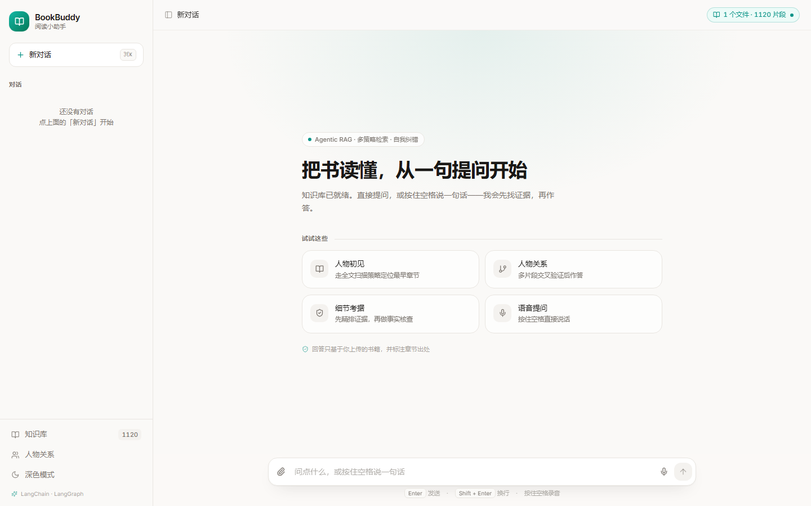
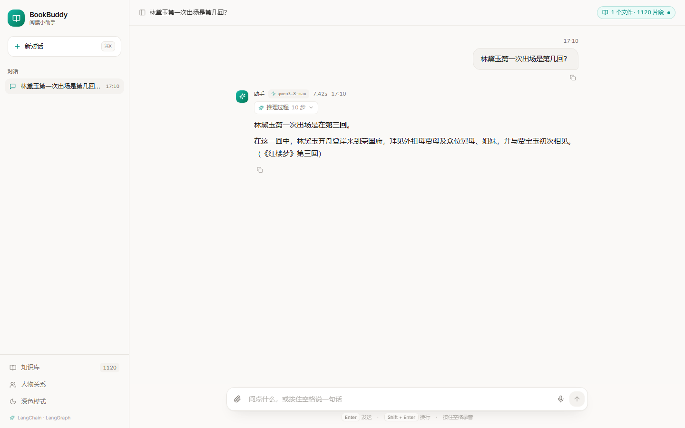
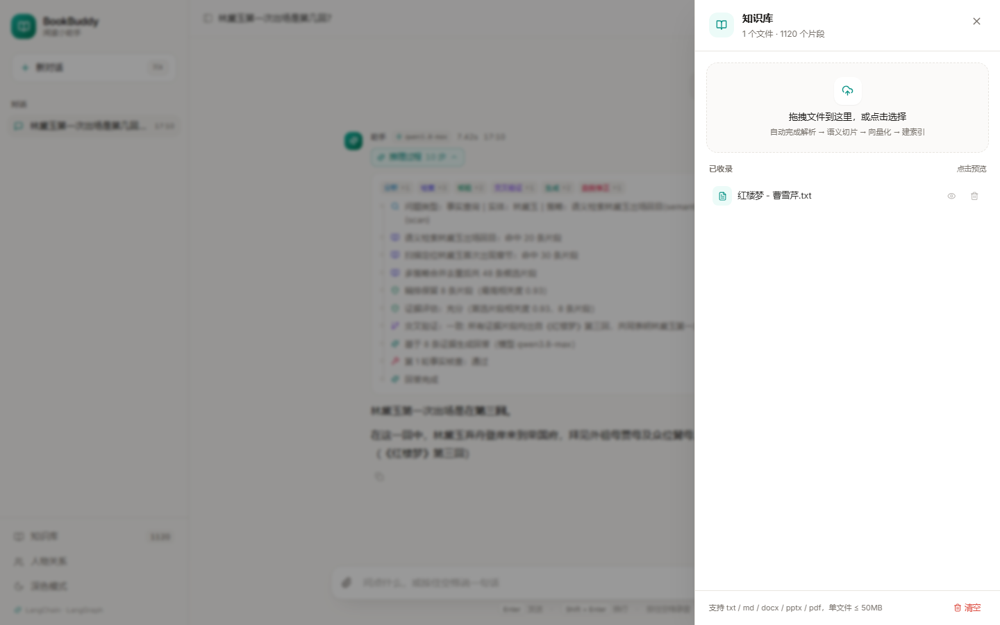
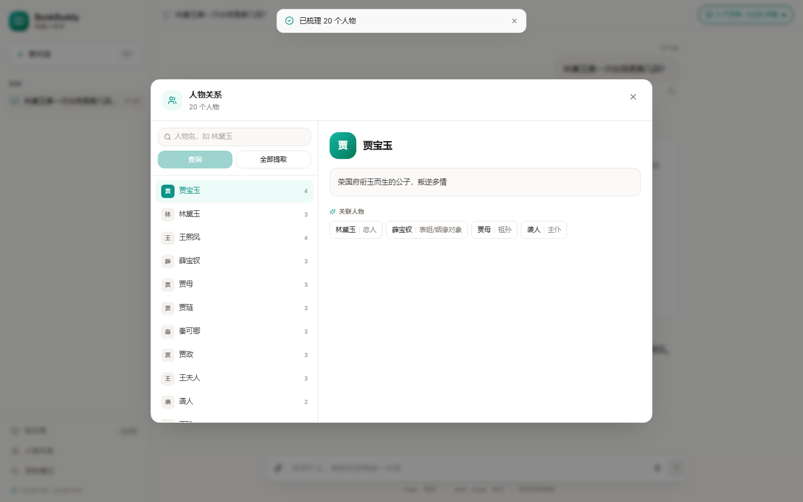
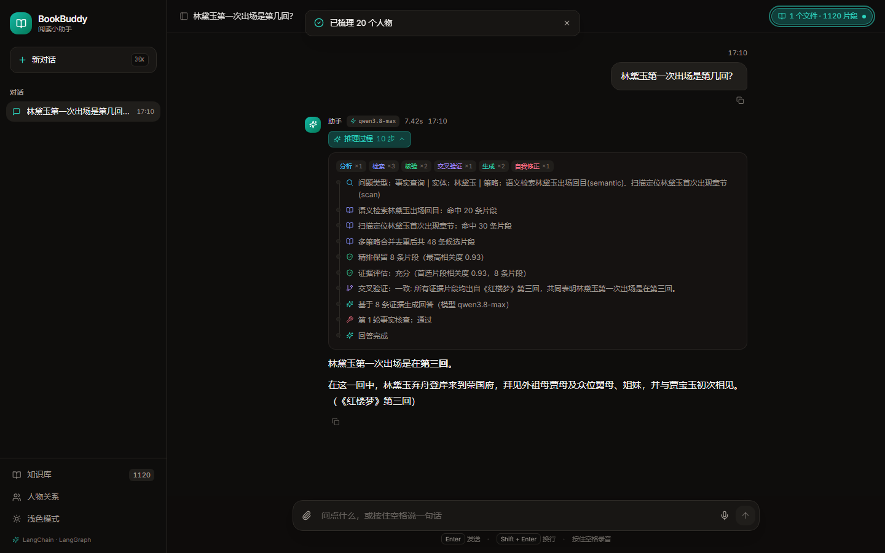

# BookBuddy · 阅读小助手

> 基于 **LangChain + LangGraph** 的语音 / 文本阅读问答助手。上传书籍，即可围绕书中内容提问，
> 也可以直接说话提问 —— 系统自动完成 **语音识别 → 混合检索 → 证据评估 → 交叉验证 → 生成 → 自我纠错**。

本项目复刻并重构了 `voice-qa-assistant` 的全部功能，后端改为 **Python + LangChain + LangGraph**
的智能体实现，模型全部通过 **阿里云百炼（DashScope）OpenAI 兼容接口** 调用，并**自动选择最合适的模型**。

前端为全新设计的「暖白纸感 + 墨绿强调」极简界面：Tailwind CSS 设计令牌、framer-motion 动效、
lucide 图标，深浅色双主题、移动端自适应。

| 首页 / 空状态 | 对话与推理过程 |
|---|---|
|  |  |

| 知识库抽屉 | 人物关系 | 深色模式 |
|---|---|---|
|  |  |  |

---

## 一、功能清单

| 模块 | 能力 |
|------|------|
| 📚 知识库管理 | 上传 `.txt / .md / .docx / .doc / .pptx / .ppt / .pdf`，自动语义切片、向量化、建 BM25 索引；支持预览、单文件删除、一键清空 |
| 🎙️ 语音问答 | 浏览器录音（按住空格说话）或上传音频；波形图 + MFCC 热力图可视化；自动 ASR + 清洗 + 回答 |
| 💬 文本问答 | 直接输入问题，走同一套 Agentic RAG 流程 |
| 🔀 混合检索 | FAISS 向量检索 + BM25 关键词检索，RRF 融合；Rerank 精排过滤 |
| 🧠 Agentic RAG | LangGraph 状态图：问题分类 → 多策略召回 → 证据评估 → 补检索 → 交叉验证 → 合成 → 事实核查 → 改写（两个循环） |
| 👥 人物关系 | 从知识库中抽取人物与关系，支持按人物名查询或全部提取 |
| 🕘 会话记忆 | 多轮对话上下文持久化（`backend/data/sessions.json`），重启后仍可追问 |
| 🌗 界面 | 深浅色主题、多会话侧边栏、Agent 思考过程可视化、Markdown 渲染 |

---

## 二、环境要求

| 依赖 | 版本 |
|------|------|
| Python | 3.10 ~ 3.12（推荐 3.11） |
| Node.js | ≥ 18（推荐 20+） |
| 系统 | Windows 10/11 / macOS / Linux |

> **本仓库已在项目目录内创建独立虚拟环境 `.venv`，所有 Python 包也安装在该环境内**
> （`node_modules` 同样在 `frontend/` 内），不污染系统环境。

---

## 三、目录结构

```
BookBuddy/
├── .venv/                     # Python 虚拟环境（本项目专用）
├── .env                       # API KEY 等配置
├── .env.example
├── requirements.txt
├── test_audio/                # 测试音频
├── test_docs/                 # 测试文档（红楼梦第一至三回节选）
├── tests/                     # 自检 / 端到端测试脚本
│
├── backend/                   # ---------- Python 后端 ----------
│   ├── app.py                 # Flask 入口 + 全部 REST 接口
│   ├── config.py              # 配置（路径 / 模型候选 / 检索参数）
│   ├── models.py              # 模型自动发现与选择
│   ├── llm.py                 # ChatOpenAI 工厂 + 统一调用封装
│   ├── prompts.py             # 全部 Prompt
│   ├── graph.py               # ★ LangGraph 智能体（核心）
│   ├── memory.py              # 会话记忆持久化
│   ├── characters.py          # 人物关系抽取
│   ├── knowledge/
│   │   ├── loaders.py         # 文档解析（txt/md/docx/pptx/pdf）
│   │   ├── splitter.py        # 章节感知切片器（LangChain TextSplitter）
│   │   ├── embeddings.py      # OpenAIEmbeddings（百炼）
│   │   ├── rerank.py          # DashScopeReranker（BaseDocumentCompressor）
│   │   └── store.py           # 混合知识库（FAISS + BM25 + RRF）
│   ├── speech/
│   │   ├── preprocess.py      # 降噪 / 归一化 / MFCC / 可视化
│   │   ├── asr.py             # qwen3-asr-flash 语音识别
│   │   └── cleaner.py         # ASR 文本清洗（RunnableLambda）
│   └── data/                  # 运行时数据（知识库、日志、会话）
│
└── frontend/                  # ---------- React 前端 ----------
    ├── dist/                  # 已构建产物（由后端直接托管）
    ├── src/lib/recorder.ts    # 浏览器录音 → 16kHz WAV
    ├── src/AppShell.tsx          # 布局 + 主题 + 会话持久化
    ├── src/lib/                  # api / recorder（16kHz WAV）/ toast / 格式化
    ├── src/components/           # NavSidebar / ChatHeader / ComposerBar /
    │                             # MessageBubble / KnowledgePanel / CharactersPanel
    ├── src/components/ui/        # Modal / Sheet / Toaster
    ├── src/pages/ChatPage.tsx
```

---

## 四、快速开始

### 1. 配置 API KEY

编辑根目录 `.env`：

```ini
DASHSCOPE_API_KEY=sk-xxxxxxxxxxxxxxxx
```

模型无需手工指定 —— 启动时会自动探测并选择（见下文「模型自动选择」）。

### 2. 启动后端

依赖已经装好，直接启动即可（**任意终端**均可，注意用项目内的 `.venv`）：

```bash
cd backend
..\.venv\Scripts\python.exe app.py
```

或者不切目录，一行搞定：

```bash
.venv\Scripts\python.exe backend\app.py
```

> 如果终端里有 conda `(base)`，**不要**直接敲 `python app.py`，那会用 Anaconda 的 python，
> 报 `No module named 'langchain'`。

启动后会打印本次选中的模型：

```
==============================================================
  BookBuddy · 阅读小助手  (LangChain + LangGraph)
==============================================================
  agent      → qwen3.8-max
  chat       → qwen3.7-plus
  fast       → qwen3.7-flash
  embedding  → qwen3.7-text-embedding
  rerank     → qwen3.7-text-rerank
  asr        → qwen3-asr-flash
  知识库     → 0 个文件 / 0 个片段
==============================================================
  API: http://127.0.0.1:5000
```

### 3. 打开页面

后端会同时托管**已经构建好**的前端（`frontend/dist/`），所以只需要启动后端，然后浏览器访问
**http://127.0.0.1:5000** 即可。

> 需要改前端代码时才启动 Vite 开发服务器（端口 3000，带热更新）：
> `cd frontend && npm install && npm run dev`。
>
> 改完后重新构建静态产物，后端会自动托管新的 `dist/`：
>
> ```bash
> cd frontend
> npm run build      # Tailwind + Vite，产物约 540KB（gzip 174KB）
> ```

### 4. 前端设计系统

界面不是套用现成 UI 库，而是基于 Tailwind 的设计令牌自绘，便于统一改色改密度：

| 令牌 | 浅色 | 深色 | 用途 |
|------|------|------|------|
| `canvas` | `#faf9f7` 暖白 | `#0e0d0c` 墨黑 | 页面底色 |
| `surface` | `#ffffff` | `#181614` | 卡片 / 输入框 |
| `subtle` | `#f4f2ef` | `#201e1b` | 内嵌块 / 用户气泡 |
| `ink` / `muted` | `#1a1816` / `#7a746e` | `#f6f4f1` / `#a09a93` | 正文 / 次要文字 |
| `accent` | `#0d9488` 墨绿 | `#2dd4bf` | 强调、按钮、当前状态 |

改动色只需编辑 `frontend/src/index.css` 顶部的 CSS 变量，Tailwind 配置通过
`rgb(var(--c-*) / <alpha-value>)` 映射，`bg-accent/10` 这类透明度写法同样生效。
动效统一由 framer-motion 驱动，并遵循系统「减少动态效果」偏好（`MotionConfig reducedMotion="user"`）。

---

## 五、模型自动选择

`backend/models.py` 在启动时请求 `GET /models` 拉取当前 API KEY 可见的全部模型，
再按「角色 → 候选优先级」挑第一个真实存在的模型：

| 角色 | 用途 | 候选优先级 |
|------|------|-----------|
| `agent` | 检索规划、证据评估、交叉验证、事实核查 | `qwen3.8-max` → `qwen3.7-max` → `qwen-max` → … |
| `chat` | 常规回答合成 | `qwen3.7-plus` → `qwen3.6-plus` → `qwen-plus` → … |
| `fast` | 问题分类、简单问答 | `qwen3.7-flash` → `qwen3.6-flash` → `qwen-flash` → … |
| `embedding` | 文本向量化 | `qwen3.7-text-embedding` → `text-embedding-v4` → … |
| `rerank` | 检索结果精排 | `qwen3.7-text-rerank` → `qwen3-rerank` → … |
| `asr` | 语音识别 | `qwen3-asr-flash` → `qwen-audio-3.0-asr-flash` → … |

**运行期还会按问题复杂度动态换挡**（`ModelRegistry.generation_model`）：

- 简单的「事实查询 / 定义解释」且证据较少 → `fast` 模型（更快）
- 常规问题 → `chat` 模型
- 「对比分析 / 复杂推理」或证据 ≥ 8 条 → `agent` 模型（更强）

结果会缓存到 `backend/data/model_cache.json`（12 小时），离线时自动使用缓存。
也可以在 `.env` 里用 `AGENT_MODEL / LLM_MODEL / FAST_MODEL / ...` 强制锁定某个模型。
接口 `/api/models` 可随时查看当前选择，`POST /api/models/refresh` 可强制重新探测。

---

## 六、LangGraph 智能体结构

```
        START
          │  知识库为空？
          ├──────────────────────────► END
          ▼
      classify      问题分类 + 检索策略规划（事实/对比/复杂/时间线）
          ▼
      retrieve      多策略召回：semantic 语义 / keyword 关键词 / scan 全量扫描
          ▼
        grade       Rerank 精排 + 相关性阈值过滤
          │  无相关片段 → 拒答
          ├──────────────────────────► END
          ▼
       assess ◄───────────┐   证据充分性评估
          │               │
          ├─ 不足且可重试 ─► retrieve_more ──┘   环 1：补检索
          ├─ 证据 ≥ 3 条 ─► cross_check
          └─ 其余 ────────► synthesize
                               ▼
                           critique   事实核查（章节号/编造事实）
                               │
                     ┌─────────┴─────────┐
                有错误 │                   │ 通过 / 达上限
                       ▼                   ▼
                   rewrite ─► critique   finalize ─► END
                   环 2：Self-Refine（最多 MAX_REFINE_ROUNDS 轮）
```

状态（`AgentState`）通过 `Annotated[list, operator.add]` 累加 `steps`，
前端「Agent 思考过程」展示的就是这些步骤。

---

## 七、REST 接口

| 方法 | 路径 | 说明 |
|------|------|------|
| GET | `/api/health` | 健康检查（含知识库与模型状态） |
| GET | `/api/models` | 当前自动选中的模型 |
| POST | `/api/models/refresh` | 强制重新探测模型 |
| POST | `/api/kb/upload` | 上传文档（multipart，字段名 `file`） |
| GET | `/api/kb/stats` | 知识库统计 |
| GET | `/api/kb/preview?source=` | 预览某文件全部片段 |
| DELETE | `/api/kb/delete-source?source=` | 删除单个文件 |
| DELETE | `/api/kb/clear` | 清空知识库 |
| POST | `/api/kb/characters` | 人物关系抽取（`{"query": "林黛玉"}` 或 `{}`） |
| POST | `/api/send-text` | 文本问答（`{"text": "...", "session_id": "..."}`） |
| POST | `/api/process-audio` | 语音问答（multipart，字段名 `audio`） |

命令行验证：

```bash
curl http://127.0.0.1:5000/api/health

curl -X POST http://127.0.0.1:5000/api/send-text ^
     -H "Content-Type: application/json" ^
     -d "{\"text\":\"林黛玉的性格特点\",\"session_id\":\"demo\"}"

curl -X POST http://127.0.0.1:5000/api/process-audio ^
     -F "audio=@test_audio/林黛玉是谁.mp3" -F "session_id=demo"
```

---

## 八、音频处理链路

```
浏览器录音（Web Audio 采集 PCM）         上传音频文件
        │ 重采样 16kHz + 16bit PCM              │
        ▼                                       ▼
      recording.wav                        mp3 / wav / m4a ...
        └──────────────┬────────────────────────┘
                       ▼
     librosa 加载（16kHz 单声道）
                       ▼
     noisereduce 谱减法降噪 → 幅度归一化
                       ▼
     MFCC(13 维) → matplotlib 波形图 / 热力图（base64 PNG）
                       ▼
     qwen3-asr-flash（原生多模态接口，data URI 直传）
                       ▼
     文本清洗（标点规范化 / 去语气词）
                       ▼
                LangGraph 问答
```

> 浏览器端之所以把录音编码成 **WAV** 而不是 webm：后端用 libsndfile 解码，
> 不依赖 ffmpeg，波形与 MFCC 分析也更稳定。上传 webm/m4a 时若系统装有 ffmpeg 会自动转码。

---

## 九、关键参数（`.env` 可覆盖）

| 变量 | 默认 | 说明 |
|------|------|------|
| `CHUNK_SIZE` | 800 | 单片段最大字符数 |
| `RETRIEVE_TOP_K` | 20 | 粗排召回数量 |
| `RERANK_TOP_N` | 8 | 精排保留数量 |
| `RERANK_MIN_SCORE` | 0.1 | 相关性阈值，低于则丢弃 |
| `MAX_RETRIEVAL_ROUNDS` | 2 | 补检索最大轮次 |
| `MAX_REFINE_ROUNDS` | 2 | 自我修正最大轮次 |
| `MAX_HISTORY_TURNS` | 20 | 对话上下文轮数 |
| `ENABLE_THINKING` | 0 | 是否开启模型思考模式。百炼 qwen3.x 会先输出 reasoning_content，若 `max_tokens` 被思考吃满则返回空内容；默认关闭以保证稳定与速度 |

---

## 十、常见问题

**Q1：启动报「未设置 DASHSCOPE_API_KEY」**
检查根目录 `.env` 是否存在、键名是否正确。

**Q2：上传大 PDF 很久 / 失败**
单文件上限 50MB；长文档向量化需要分批调用 embedding，属正常耗时。

**Q3：点击麦克风没反应**
浏览器需要麦克风权限；`http://localhost` 视为安全上下文，可直接授权。
若用局域网 IP 访问，需 HTTPS 才能使用录音。

**Q4：ASR 报「format is empty」**
说明当前模型不是 ASR 模型或音频格式不支持。系统会自动按候选顺序切换模型；
仍失败时查看后端日志中每个候选模型的报错。

**Q5：回答总是「知识库中暂无相关信息」**
说明精排后没有超过阈值的片段。可降低 `RERANK_MIN_SCORE`（如 0.05），
或确认上传的文档确实包含相关内容。

---

## 十一、测试与自检

```bash
# 1) 模块级自检（会真实调用 API：模型发现 / embedding / rerank / ASR / 音频管线 / 构图）
.venv\Scripts\python.exe tests\selftest.py

# 2) 接口级检查（知识库上传 / 预览 / 幂等重传 / 删除），需要后端已启动
.venv\Scripts\python.exe tests\api_check.py

# 3) 端到端冒烟（上传 → 文本问答 → 语音问答 → 人物关系）
.venv\Scripts\python.exe tests\smoke_test.py
.venv\Scripts\python.exe tests\smoke_test.py --skip-upload

# 4) 多轮对话（验证"她/他"之类代词的跨轮消解）
.venv\Scripts\python.exe tests\multiturn_check.py
```

---

## 十二、技术栈

| 层 | 技术 |
|----|------|
| 编排 | **LangGraph**（StateGraph / 条件边 / 双循环 / 状态累加器） |
| 模型接入 | **LangChain**：`ChatOpenAI`、`OpenAIEmbeddings`、`TextSplitter`、`BaseDocumentCompressor`、`RunnableLambda`、LCEL |
| 服务 | Flask + flask-cors |
| 检索 | FAISS（faiss-cpu）+ rank_bm25 + jieba + RRF 融合 |
| 文档 | python-docx / python-pptx / pdfplumber |
| 音频 | librosa / soundfile / noisereduce / numpy / matplotlib |
| 前端 | React 18 + TypeScript + Vite + **Tailwind CSS 3** + framer-motion + lucide-react + react-markdown |
| 模型服务 | 阿里云百炼 DashScope（OpenAI 兼容模式 + 原生多模态） |
